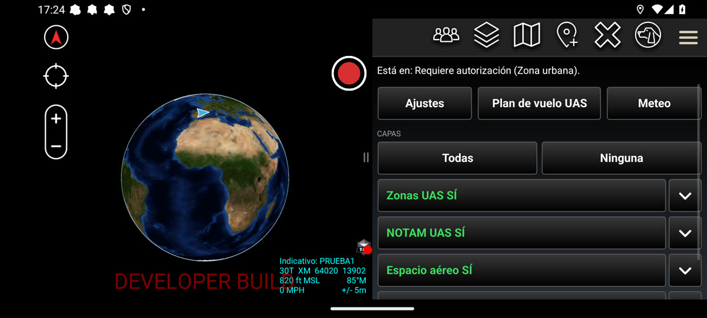
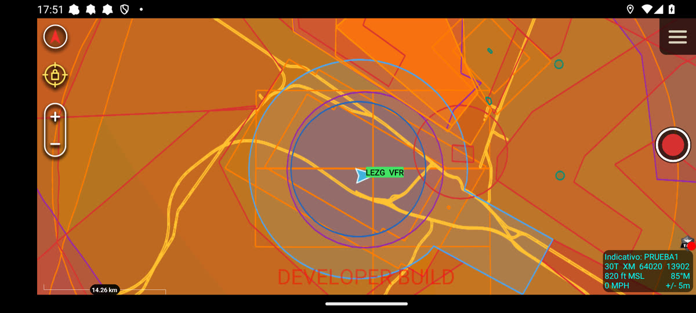
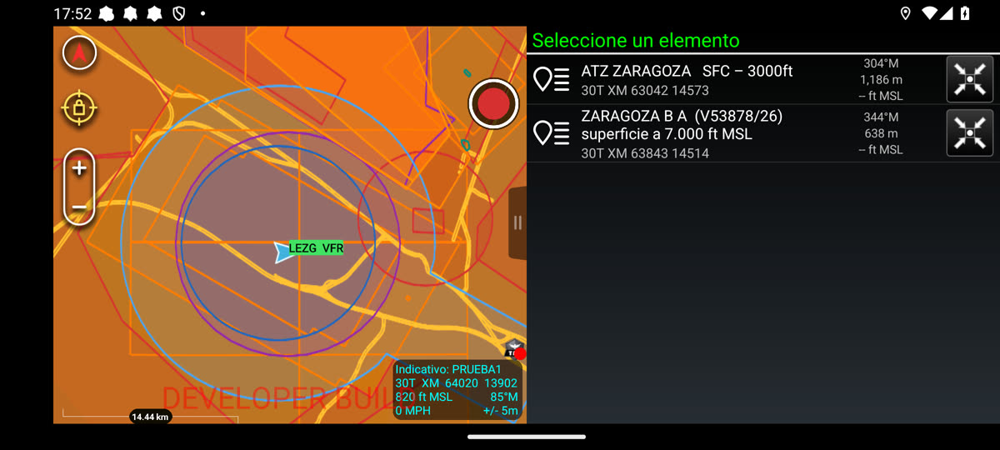
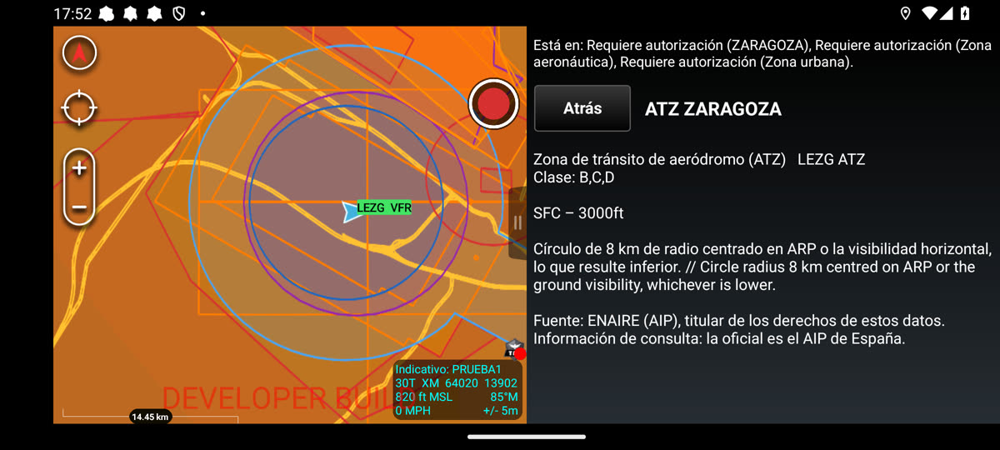
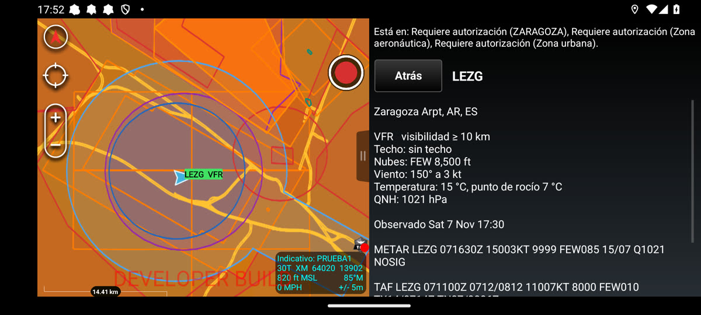
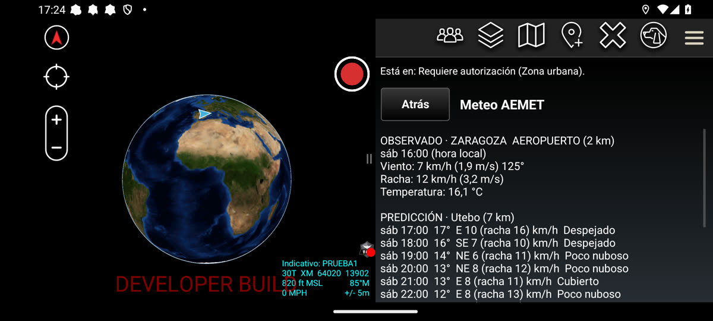
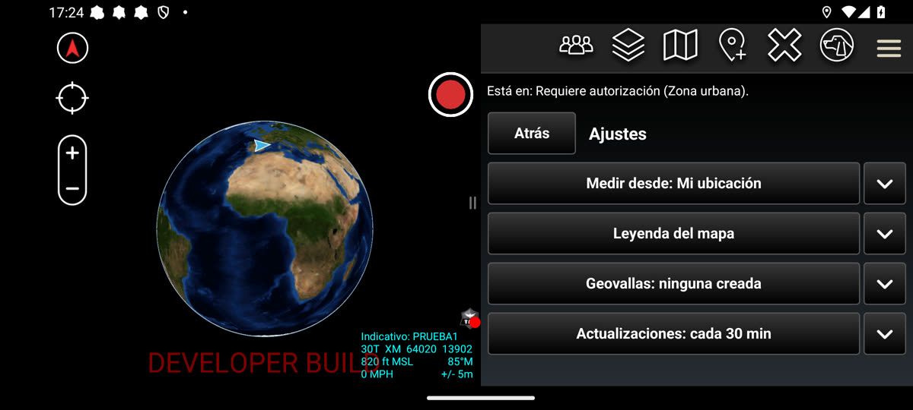
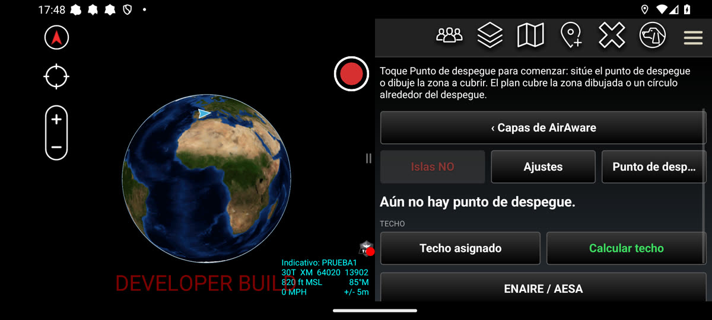
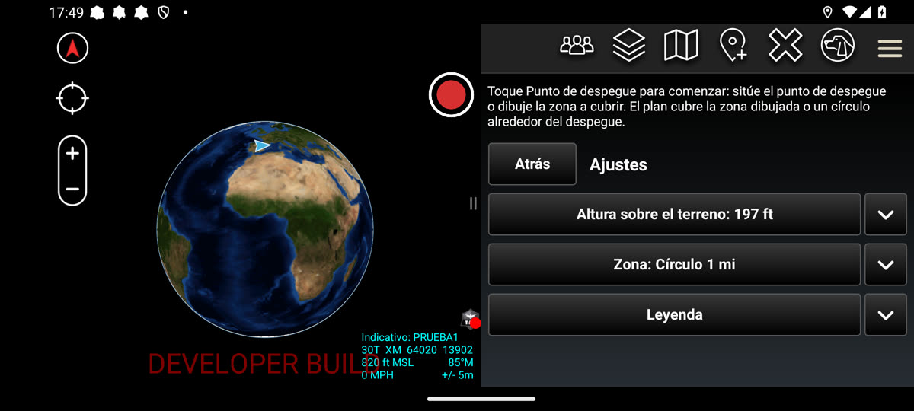
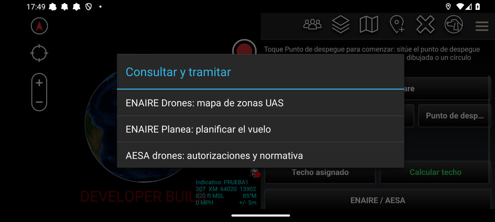

# Guía de usuario de AeroZona / AeroZona User Guide

**Version 1.0.4 · Guía de usuario / User Guide**

**Download AeroZona 1.0.4** (pick the one matching your ATAK-CIV version, sideload, then load it in ATAK's Plugins manager):

- **ATAK-CIV 5.8:** https://github.com/carlosgt91/aerozona/releases/download/v1.0.4/ATAK-Plugin-AeroZona-1.0.4--5.8.0-civ-release.apk

All releases: https://github.com/carlosgt91/aerozona/releases

---

## Índice / Table of Contents

- [Español](#español)
  - [1. Visión general](#1-visión-general)
  - [2. Antes de empezar](#2-antes-de-empezar)
  - [3. El mapa y las capas](#3-el-mapa-y-las-capas)
  - [4. Zonas UAS (RD 517/2024)](#4-zonas-uas-rd-5172024)
  - [5. NOTAM UAS](#5-notam-uas)
  - [6. Espacio aéreo](#6-espacio-aéreo)
  - [7. Ficha de espacio aéreo](#7-ficha-de-espacio-aéreo)
  - [8. Condiciones METAR](#8-condiciones-metar)
  - [9. Meteorología AEMET](#9-meteorología-aemet)
  - [10. Ajustes del panel](#10-ajustes-del-panel)
  - [11. Plan de vuelo UAS](#11-plan-de-vuelo-uas)
  - [12. Ajustes del planificador](#12-ajustes-del-planificador)
  - [13. ENAIRE, AESA y tramitación](#13-enaire-aesa-y-tramitación)
  - [14. Operación sin datos o sin red](#14-operación-sin-datos-o-sin-red)
  - [15. Avisos y fuentes oficiales](#15-avisos-y-fuentes-oficiales)
- [English](#english)
  - [1. Overview](#1-overview)
  - [2. Before You Start](#2-before-you-start)
  - [3. The Map and Layers](#3-the-map-and-layers)
  - [4. UAS Zones (RD 517/2024)](#4-uas-zones-rd-5172024)
  - [5. UAS NOTAMs](#5-uas-notams)
  - [6. Airspace](#6-airspace)
  - [7. Airspace Details](#7-airspace-details)
  - [8. METAR Conditions](#8-metar-conditions)
  - [9. AEMET Weather](#9-aemet-weather)
  - [10. Panel Settings](#10-panel-settings)
  - [11. UAS Flight Plan](#11-uas-flight-plan)
  - [12. Planner Settings](#12-planner-settings)
  - [13. ENAIRE, AESA and Coordination](#13-enaire-aesa-and-coordination)
  - [14. Missing Data and Offline Operation](#14-missing-data-and-offline-operation)
  - [15. Official Sources and Legal Notices](#15-official-sources-and-legal-notices)

---

# Español

### 1. Visión general

AeroZona muestra en su pantalla la situación aeronáutica sobre el terreno en España: **qué zonas y restricciones coinciden con su posición y qué condiciones aplican a la columna de aire**.

Abra AeroZona desde el menú de herramientas de ATAK. El panel se abre a media anchura. La línea superior **«Está en:»** resume las zonas y NOTAM en su posición GPS o en el punto de referencia designado en el mapa.

Diseñado para pilotos civiles de drones (UAS). Las zonas deportivas se muestran a título de referencia aeronáutica.

---

### 2. Antes de empezar

- **Carácter exclusivamente consultivo.** AeroZona no es una fuente oficial ni constituye una autorización de vuelo. Consulte siempre las fuentes oficiales: AIP España, ENAIRE Drones (`drones.enaire.es`), Ícaro XXI para NOTAM y AESA (`seguridadaerea.gob.es`).
- **Derechos sobre los datos.** La información aeronáutica es titularidad de ENAIRE («ENAIRE es el titular de los derechos de estos datos»); la información meteorológica es © AEMET; los informes METAR y TAF proceden de `aviationweather.gov`.
- **Privacidad.** Nada se transmite a un TAK Server ni a otros usuarios. El teléfono únicamente consulta a ENAIRE, aviationweather.gov y, con su clave personal, a AEMET.
- **Unidades de medida.** Se adoptan las unidades configuradas en ATAK (distancia y altitud). Se recomienda configurar ATAK en sistema métrico.

---

### 3. El mapa y las capas

Tres capas cartográficas independientes: **Zonas UAS**, **NOTAM UAS** y **Espacio aéreo**. Cada una dispone de conmutador propio y opciones bajo la flecha.

Los accesos **Todas** y **Ninguna** activan o despejan la cartografía con un solo toque.

**Operación sin cobertura.** Las zonas se descargan por cuadrículas de 0,25° y se conservan 7 días (ciclo AIRAC de 28 días). Una zona visualizada previamente permanece accesible sin conexión a internet.

---

### 4. Zonas UAS (RD 517/2024)

Zonas geográficas de UAS publicadas oficialmente por ENAIRE conforme al Real Decreto 517/2024, estructuradas en tres agrupaciones: **Infraestructuras**, **Aero** y **Urbano**.

- **Rojo:** Vuelo prohibido.
- **Naranja:** Requiere autorización o coordinación previa de la autoridad u operador afectado.
- **Amarillo:** Sujeto al cumplimiento de condiciones o requisitos operacionales específicos.
- **Verde:** Sin restricciones específicas para UAS.

Los límites verticales se indican en metros AGL (sobre el terreno) o AMSL (sobre el nivel del mar) según los publica oficialmente ENAIRE. Se descargan por bloques de 0,25° y se conservan 7 días en el dispositivo.

---

### 5. NOTAM UAS

Avisos a los navegantes específicos para operaciones de UAS procedentes de ENAIRE, actualizados cada 30 minutos.

- **Magenta:** Actividad de UAS en curso o programada.
- **Rojo:** Restricción de área en vigor.
- **Violeta:** Otros avisos aeronáuticos y operativos.

Se representan en el mapa únicamente durante sus fechas de validez general. El horario diario programado (por ejemplo, LUN-VIE 0600-1400) se indica en el texto informativo, pero no se computa algorítmicamente; verifique siempre el horario concreto antes del vuelo.

---

### 6. Espacio aéreo

Espacio aéreo oficial publicado por ENAIRE: CTR, ATZ/FIZ, zonas Prohibidas (P), Restringidas (R), Peligrosas (D), TRA/TSA, RMZ/TMZ y zonas deportivas ENR 5.5 (paracaidismo, veleros, aeromodelos, RPAS).

Contorno verde azulado (*teal*); solo P y R van rellenas de color. Se excluyen zonas con suelo en nivel de vuelo (FL) o igual o superior a 5.000 ft. Todo el país se descarga en un único paquete y se guarda 7 días.

Al tocar el mapa, ATAK despliega **«Seleccione un elemento»** con todas las zonas coincidentes bajo el dedo.

---

### 7. Ficha de espacio aéreo

Toque cualquier zona para ver su ficha técnica: clase, límites superior e inferior, servicio ATS y frecuencias de radio.

Cuando se dispone de frecuencia, se detalla la frecuencia de sintonía y su correspondiente canal de 8,33 kHz.

**Importante:** ENAIRE no publica la frecuencia de muchos CTR y ATZ (como Zaragoza); consulte en ese caso el AIP AD 2.18 de dicho aeródromo. Cada ficha indica la fuente y el titular de los derechos de los datos.

---

### 8. Condiciones METAR

Distintivo por aeródromo coloreado según la categoría de vuelo aeronáutica estándar de `aviationweather.gov`:
- **Verde:** VFR
- **Azul:** MVFR
- **Rojo:** IFR
- **Magenta:** LIFR

Al tocar la ficha se detalla: visibilidad horizontal en km, techo y capas de nubes, viento, temperatura, QNH en hPa y hora de observación. Incluye los textos íntegros originales de los boletines METAR y TAF para comprobación directa del piloto.

---

### 9. Meteorología AEMET

El botón **Meteo** conecta directamente con AEMET OpenData. Requiere una clave API personal y gratuita, configurable en **Ajustes de ATAK > Preferencias de herramientas > AeroZona > AEMET** (con guía PDF integrada para obtenerla).

Arriba aparecen los avisos Meteoalerta de AEMET (amarillo, naranja o rojo) que cubren su posición, el más grave primero, con inicio, fin y descripción.

Muestra la estación AEMET más cercana (hasta 60 km) con viento sostenido, rachas, temperatura y visibilidad, junto con la predicción horaria municipal a 12 horas en hora local (incluidas las Islas Canarias).

Rachas de 10 m/s (36 km/h) o más se marcan con ⚠. Caché: avisos 15 min, observaciones 30 min, predicción 60 min.

---

### 10. Ajustes del panel

Accesible desde el botón **Ajustes** del panel principal:

- **Medir desde:** calcula distancias y la línea «Está en:» desde su posición GPS o desde un punto designado en el mapa.
- **Leyenda del mapa:** relación completa de colores y símbolos activos en cartografía.
- **Actualizaciones:** frecuencia de renovación en segundo plano de restricciones y datos meteorológicos.

---

### 11. Plan de vuelo UAS

Pantalla propia abierta desde el botón **Plan de vuelo UAS**. Responde a dos cuestiones esenciales ante la coordinación aeronáutica: **qué techo requiere la misión** y **qué afección causa un techo asignado**.

- **Punto de despegue:** fijado por GPS o tocando el mapa. Se borra con la papelera de su menú radial o con **Borrar todo** (en **Punto de despegue**); ambos limpian el plan entero.
- **Área de operación:** círculo de radio configurable o polígono dibujado a medida.
- **Altura sobre el terreno (AGL):** preajustes de 30, 60, 90 y 120 m (límite de categoría abierta según RD 517/2024; una zona UAS local puede restringir a cotas inferiores).
- **Calcular techo:** suma la cota máxima del relieve en el área y la altura de vuelo, redondeando hacia arriba a los siguientes 100 ft.
- **Techo asignado:** evalúa el margen libre respecto a un límite impuesto.
- **Islas:** colorea en rojo el terreno que excede el techo asignado y en azul el relieve admisible. Requiere datos de elevación (DTED).

---

### 12. Ajustes del planificador

Configuración específica del cálculo de misión:

- **Altura sobre el terreno:** define la cota que se mantendrá sobre el relieve en todo momento.
- **Zona:** radio del círculo de operación en torno al punto de despegue.
- **Leyenda:** simbología cromática de las curvas de análisis de terreno e islas críticas.

Todos los valores configurados se conservan entre sesiones sin necesidad de conexión.

---

### 13. ENAIRE, AESA y tramitación

El botón **ENAIRE / AESA** conecta con las plataformas oficiales:

- **ENAIRE Drones:** mapa interactivo oficial de zonas geográficas de UAS (`drones.enaire.es`).
- **ENAIRE Planea:** plataforma formal para tramitar solicitudes de coordinación de vuelo (`planea.enaire.es`).
- **AESA Drones:** portal de normativa, autorizaciones de operador y requisitos reglamentarios (`seguridadaerea.gob.es`).

**Resumen de la operación:** genera un texto con coordenadas de despegue, superficie del área y alturas listo para copiar y pegar en ENAIRE Planea. No tramita ni concede autorizaciones de vuelo por sí mismo.

---

### 14. Operación sin datos o sin red

- **Sin datos de elevación (DTED).** El planificador lee los modelos de elevación DTED alojados en ATAK. Si faltan datos en la zona, el complemento lo advierte abiertamente y deja el terreno sin pintar, evitando calcular techos irreales sin datos. Cargue la cartografía DTED para habilitar el análisis de relieve.
- **Sin conexión de red.** Las zonas UAS y el espacio aéreo descargados permanecen 7 días en memoria. Si una consulta falla o no hay señal, el mapa no se borra.
- **Información explícita.** La barra de estado indica en texto claro qué fuentes no han podido contactarse. Un mapa despejado no presupone un cielo libre de restricciones.

---

### 15. Avisos y fuentes oficiales

- **Carácter consultivo.** Los datos mostrados reflejan la información pública en el momento de su descarga. No sustituyen los avisos aeronáuticos oficiales, el AIP ni las autorizaciones de coordinación con proveedores ATS o AESA.
- **Fuentes oficiales:** AIP España, ENAIRE Drones (`drones.enaire.es`), Ícaro XXI para NOTAM y portal de AESA (`seguridadaerea.gob.es`).
- **Propiedad intelectual:** Datos aeronáuticos titularidad de ENAIRE («ENAIRE es el titular de los derechos de estos datos»). Meteorología © AEMET. Datos METAR/TAF procedentes de `aviationweather.gov`. Relación de municipios de Wikidata (CC0).
- **Privacidad.** No se comparten trazas ni ubicaciones con ningún TAK Server ni con terceros.

---

# English

### 1. Overview

AeroZona provides immediate situational awareness for civil drone (UAS) operations in Spain: **which geographic zones and NOTAMs apply at your position, and what rules govern the airspace**.

Open AeroZona from ATAK's Tools menu; the pane opens at half width. The top **"Está en:"** ("You are in:") status line summarizes active zones and NOTAMs at your GPS coordinate or designated map reference point.

Built specifically for civil drone (UAS) pilots; sporting aviation areas (gliders, parachuting, model aircraft, RPAS) are included for aeronautical reference.

---

### 2. Before You Start

- **Advisory only.** AeroZona is not an official aeronautical source and does not constitute a flight clearance. Always verify current information with official authorities: AIP España, ENAIRE Drones (`drones.enaire.es`), Ícaro XXI for NOTAMs, and AESA (`seguridadaerea.gob.es`).
- **Data ownership.** Aeronautical information is owned by ENAIRE ("ENAIRE es el titular de los derechos de estos datos"); weather data is © AEMET; METAR/TAF observations are retrieved from `aviationweather.gov`.
- **Privacy.** Nothing is transmitted to any TAK Server or shared with other users. Your device queries only ENAIRE, aviationweather.gov, and (with your personal API key) AEMET.
- **Units.** Distances and altitudes follow ATAK's display preferences. Setting ATAK to metric units is recommended.

---

### 3. The Map and Layers

Three primary cartographic layers: **UAS Zones** ("Zonas UAS"), **UAS NOTAMs** ("NOTAM UAS"), and **Airspace** ("Espacio aéreo"). Each can be toggled individually.

**All on** ("Todas") and **All off** ("Ninguna") buttons enable or clear all map layers with a single tap. The arrow on each row accesses its specific options.

**Offline caching.** Zones download in 0.25° tiles around the viewed area and are stored locally for 7 days (aligned with the 28-day AIRAC cycle). An area viewed once remains fully available without a network connection.

---

### 4. UAS Zones (RD 517/2024)

Spanish UAS geographic zones published by ENAIRE pursuant to Royal Decree 517/2024 (RD 517/2024), classified into three official groups: **Infrastructures** (*Infraestructuras*), **Aviation** (*Aero*), and **Urban** (*Urbano*).

- **Red:** Prohibited to UAS flights.
- **Orange:** Prior authorization or coordination mandatory with the designated authority or facility operator.
- **Yellow:** Specific operational conditions and requirements apply.
- **Green:** Free of specific UAS restrictions.

Vertical limits are stated in metres AGL (above ground level) or AMSL (above mean sea level) as published by ENAIRE. Cached on device for 7 days.

---

### 5. UAS NOTAMs

Notices to Airmen specifically for UAS operations published by ENAIRE, refreshed automatically every 30 minutes.

- **Magenta:** Active or scheduled UAS activity.
- **Red:** Airspace restriction in force.
- **Violet:** Other notices and operational warnings.

Drawn on the map only within their published effective calendar dates. The daily operating schedule (e.g., MON-FRI 0600-1400) is shown in the text but not evaluated programmatically; always check the specific schedule before flying.

---

### 6. Airspace

Comprehensive Spanish controlled airspace published by ENAIRE: CTR, ATZ/FIZ, Prohibited (P), Restricted (R), Danger (D), TRA/TSA, RMZ/TMZ, and ENR 5.5 sporting activities (parachuting, gliding, model aircraft, RPAS).

Outlined in teal; only P and R zones carry solid color fill. Volumes with floors at a flight level (FL) or at or above 5,000 ft are excluded. Nationwide data downloads in a single pack and caches for 7 days.

Tapping the map opens ATAK's **Select an item** ("Seleccione un elemento") menu listing every zone beneath your finger.

---

### 7. Airspace Details

Tap any listed airspace feature to open its details sheet: airspace class, upper and lower vertical limits, service provided, and radio frequencies.

When available, the communication frequency and its 8.33 kHz channel spacing are clearly indicated.

**Important:** ENAIRE does not publish radio frequencies for many CTRs and ATZs (such as Zaragoza); consult AIP AD 2.18 for that aerodrome. Every sheet explicitly cites the data source and copyright holder (ENAIRE).

---

### 8. METAR Conditions

Each airfield displays a flight-category chip per standard aviation rules from `aviationweather.gov`:
- **Green:** VFR
- **Blue:** MVFR
- **Red:** IFR
- **Magenta:** LIFR

Tap a chip for detailed surface conditions: horizontal visibility in km, cloud ceiling and cloud layers, wind direction and speed, temperature, and QNH in hPa. Includes observation timestamps and the raw, unedited METAR and TAF bulletins for direct pilot verification.

---

### 9. AEMET Weather

The **Weather** ("Meteo") button queries AEMET OpenData. It requires a free personal API key configured in **ATAK Settings > Tool Preferences > AeroZona > AEMET** (where an integrated PDF guide explains how to acquire it).

Reports the nearest AEMET weather station within 60 km: sustained wind, peak gusts, temperature, and visibility, alongside 12-hour hourly municipal forecasts in local time (Canary Islands included).

Gusts of 10 m/s (36 km/h) or higher are flagged with ⚠. Surface observations cache for 30 minutes; forecasts for 60 minutes.

---

### 10. Panel Settings

Accessed from the **Settings** ("Ajustes") button on the main pane:

- **Measure from** ("Medir desde"): calculates distances and the "Está en:" status line from your GPS position or a selected map coordinate.
- **Map key** ("Leyenda del mapa"): index of all active colors and layer symbols.
- **Updates** ("Actualizaciones"): configure background refresh frequencies for restrictions and weather data.

---

### 11. UAS Flight Plan

Opened via **UAS Flight Plan** ("Plan de vuelo UAS"). Solves two vital questions for air coordination: **what ceiling does the mission require**, and **how does an assigned ceiling affect the flight**.

- **Launch point:** set via GPS or tap the map.
- **Mission area:** circular buffer with adjustable radius or custom drawn polygon.
- **Height above terrain (AGL) presets:** 30, 60, 90, and 120 m (open category ceiling under RD 517/2024; local zones may specify less).
- **Calculate ceiling:** finds highest terrain in the mission area + flight height, rounded up to the next 100 ft.
- **Assigned ceiling:** evaluates clearance against assigned limits.
- **Islands:** highlights ground breaching ceiling in red; safe relief in blue. Requires DTED elevation data.

---

### 12. Planner Settings

Configure mission analysis variables from planner settings:

- **Height above terrain** ("Altura sobre el terreno"): select flight clearance above the ground profile.
- **Zone** ("Zona"): adjust radius of circular mission buffer around the launch coordinate.
- **Map key** ("Leyenda"): color definitions for terrain elevation and critical relief islands.

All flight planner preferences persist across app restarts without network connectivity.

---

### 13. ENAIRE, AESA and Coordination

The **ENAIRE / AESA** button opens direct links to official flight portals:

- **ENAIRE Drones:** official interactive map of Spanish UAS geographic zones (`drones.enaire.es`).
- **ENAIRE Planea:** official portal for submitting and managing air coordination requests (`planea.enaire.es`).
- **AESA Drones:** aviation safety agency portal for rules and certifications (`seguridadaerea.gob.es`).

**Operation summary** ("Resumen de la operación"): formats launch point, mission area, and ceilings into text ready to copy into ENAIRE Planea. This function does not grant or file flight clearances automatically.

---

### 14. Missing Data and Offline Operation

- **Missing elevation data (DTED).** The planner depends on DTED elevation loaded in ATAK. When missing for an area, the plugin states this clearly and leaves terrain unpainted rather than computing erroneous altitudes. Load DTED elevation files to enable terrain analysis.
- **Offline operation.** Downloaded UAS zones and airspace stay on the device for 7 days. If network connectivity drops or a fetch fails, existing map features remain intact.
- **Clear status.** The status line explicitly names any data sources that could not be refreshed, ensuring you know exactly what information is current.

---

### 15. Official Sources and Legal Notices

- **Advisory nature.** All presented data is strictly for situational awareness and flight planning assistance. It does not replace official aeronautical publications or mandatory air coordination with ATS providers or AESA.
- **Official sources:** AIP España, ENAIRE Drones (`drones.enaire.es`), Ícaro XXI for NOTAMs, and AESA (`seguridadaerea.gob.es`).
- **Intellectual property:** Aeronautical and zone data © ENAIRE («ENAIRE es el titular de los derechos de estos datos»). Weather data © AEMET. METAR/TAF observations courtesy of `aviationweather.gov`. Municipality dataset from Wikidata (CC0).
- **Privacy.** No position, tracking, or device telemetry is ever transmitted to a TAK Server or external entities.
